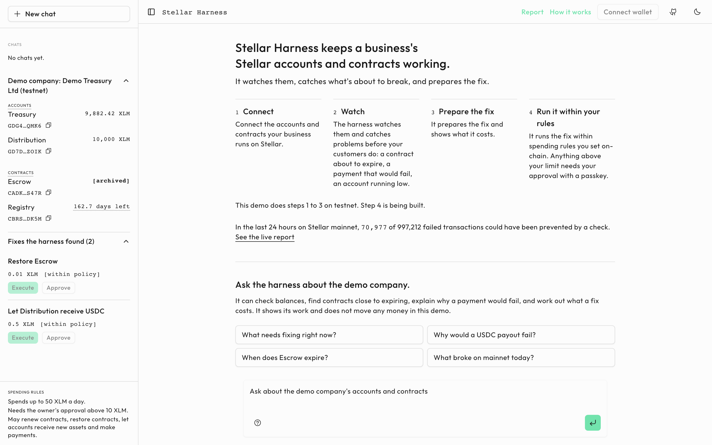

# Stellar Harness

An ops agent that keeps a business's Stellar accounts and contracts working. It watches them, catches what's about to break, and prepares the fix with its real cost. The live report shows what is breaking on Stellar mainnet right now, and the demo runs the agent against a sample company on testnet.

Live: https://stellarharness.xyz



## Run it

```bash
pnpm install
cp .env.example .env
docker compose up -d postgres
pnpm worker
pnpm dev
```

Set `OPENAI_API_KEY` in `.env`. The app runs at http://localhost:3000 and the worker at http://localhost:8787/health. On first start the worker backfills the last 24 hours of mainnet.
